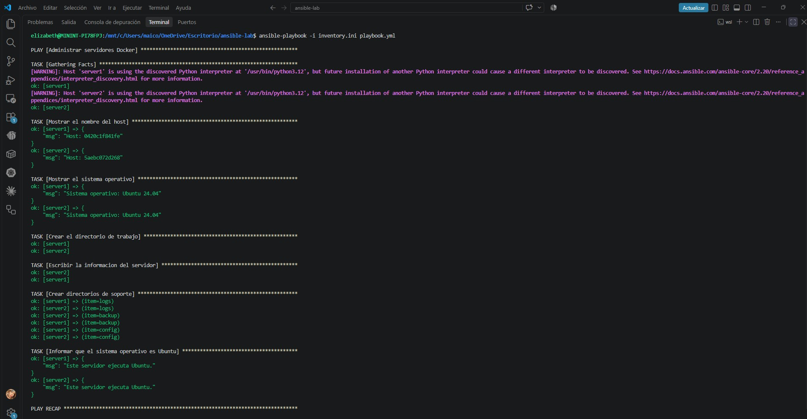
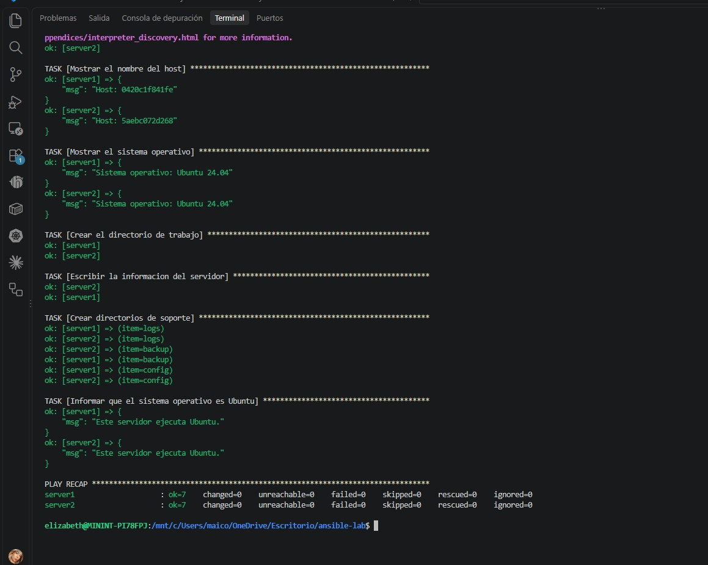

# Laboratorio de Ansible con Docker

## Objetivo

Crear dos servidores Ubuntu 24.04 en contenedores Docker y administrarlos con Ansible. El playbook muestra el nombre del host y el sistema operativo, crea `/tmp/ansible-demo/info.txt` y los directorios `logs`, `backup` y `config`, y muestra un mensaje solamente en servidores Ubuntu.

## Requisitos

- Docker y Docker Compose.
- Python 3 y Ansible instalados en el equipo desde el que se ejecuta el laboratorio.
- La colección `community.docker`, que proporciona la conexión Docker de Ansible.

Instala la colección con:

```bash
ansible-galaxy collection install community.docker
```

## Iniciar los contenedores

Desde esta carpeta, ejecuta:

```bash
docker compose up -d
docker ps
```

Instala Python 3 en ambos contenedores para que Ansible pueda recopilar datos del sistema:

```bash
docker exec server1 bash -lc "apt-get update && apt-get install -y python3"
docker exec server2 bash -lc "apt-get update && apt-get install -y python3"
```

## Comprobar la conexión y ejecutar el playbook

```bash
ansible docker -i inventory.ini -m ping
ansible-playbook -i inventory.ini playbook.yml
```


## Captura de pantalla

Ejecución exitosa del playbook (primera parte):



Ejecución exitosa del playbook (segunda parte, con el resumen final):

